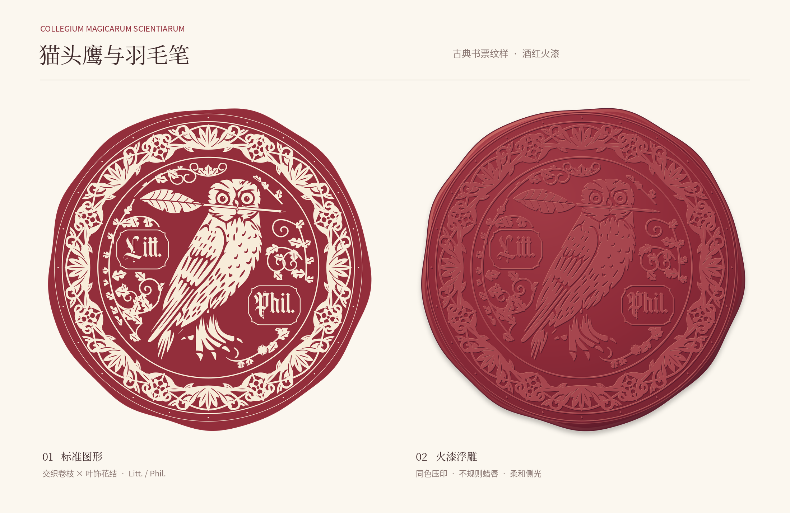
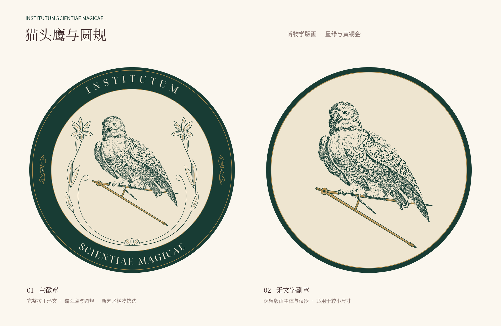

# Logo Design

两套独立设计的LOGO,分别为火漆风格与新艺术风格。这些创作来自我在一个同人项目中的需求。您可以在遵循CC BY-NC 4.0协议的前提下自由使用和更改。

## 作品

### Collegium Magicarum Scientiarum

猫头鹰与羽毛笔，酒红与暖象牙的重纹饰印章；包含标准、火漆浮雕及单色镂空版本。



[文件与生成说明](collegium-magicarum-scientiarum-logo/README.md) · [SVG](collegium-magicarum-scientiarum-logo/svg/) · [PNG](collegium-magicarum-scientiarum-logo/png/)

### Institutum Scientiae Magicae

猫头鹰与圆规，深墨绿、暖象牙与黄铜金的新艺术徽章；包含带拉丁环文的主徽章及无文字副章。



[文件与生成说明](institutum-scientiae-magicae-logo/README.md) · [SVG](institutum-scientiae-magicae-logo/svg/) · [PNG](institutum-scientiae-magicae-logo/png/)

## 文件组织

两个作品目录遵循相同约定：

```text
<logo>/
├── README.md           # 作品、文件及构建说明
├── design-preview.png  # 2200 × 1430，共享纸底、字体、留白与两栏布局
├── svg/                # 正式矢量及可编辑版本
├── png/                # 正式位图导出
├── assets/             # 构建素材、矢量组件与来源记录
└── scripts/            # 各作品的构建、导出与素材处理脚本
```

根目录 `scripts/` 提供共享预览生成及资产校验。`design-preview.png` 是展示板，使用时应下载 `svg/` 或 `png/` 中的独立标志文件。

仓库仅发布当前最新版及必要源材料。此前包含旧稿、备份和原始字体的提交历史已由当前版本的单一初始提交替换；`archive/`、`backups/`、`.local-only/`、备份压缩包和原始字体均不发布。

## 预览与校验

以下命令均在仓库根目录执行。预览生成需要 Python 3、Pillow 及可用的中文无衬线／衬线字体：

```sh
python3 -m pip install -r requirements.txt
python3 scripts/make_previews.py
python3 scripts/verify_assets.py
```

可用 `PREVIEW_SANS_FONT`、`PREVIEW_SERIF_FONT` 指定本机字体文件。共享预览脚本仅合成展示板，不重新绘制或覆盖正式 logo。两个作品的 `scripts/make_preview.py` 是该共享脚本的入口。

只有需要重新构建或导出作品时才安装 Node.js 依赖：

```sh
npm install
```

具体构建命令见各作品 README。Institutum 重建文字时可通过 `NOTO_SERIF_DISPLAY_FONT` 指定 Noto Serif Display 字体文件；不要以其他字体静默替换。构建及导出会覆盖对应产物；目录整理或调整预览时无需运行这些命令。

## 许可与署名

原创部分由 **Aurora Lucas** 以 [CC BY-NC 4.0](https://creativecommons.org/licenses/by-nc/4.0/) 发布，完整协议见 [LICENSE](LICENSE)。建议署名：

> Logo Design — Aurora Lucas，https://github.com/Aurora-Lucas/logo-design-owl/，CC BY-NC 4.0；如有修改，请注明。

公有领域素材保留原有来源与权利状态。California sun 原始字体已从当前版本移除，其现有转曲文字的再许可范围仍待核实；仓库许可仅覆盖贡献者有权许可的部分，不代表第三方权利已全部清理。详见 [THIRD_PARTY_NOTICES.md](THIRD_PARTY_NOTICES.md)。
