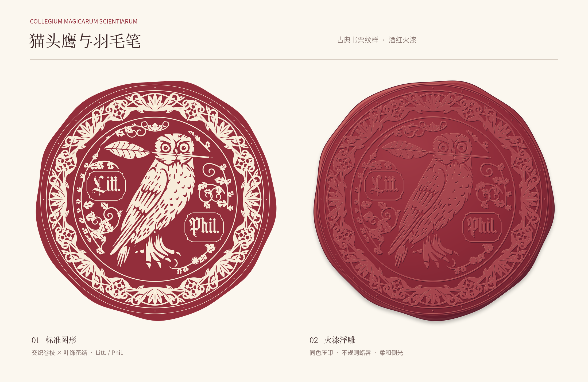

# Collegium Magicarum Scientiarum

猫头鹰与羽毛笔的重纹饰印章。现有设计保持原样：交织卷草与花结环带、内场叶饰、`Litt.`／`Phil.` 字牌，以及深酒红 `#932E3B` 与暖象牙 `#F7ECD9`。包含标准、火漆浮雕和单色镂空版本。



## 文件

| 路径 | 用途 |
| --- | --- |
| `svg/owl-quill-wax-seal.svg` | 标准主稿，外部透明 |
| `png/owl-quill-wax-seal-transparent.png` | 2048 × 2048 透明标准版 |
| `png/owl-quill-wax-seal.png` | 2048 × 2048 浅纸色背景版 |
| `svg/owl-quill-wax-seal-embossed.svg` / `png/owl-quill-wax-seal-embossed.png` | 同色火漆浮雕；PNG 为 2048 × 2048 |
| `svg/owl-quill-seal-monochrome.svg` / `png/owl-quill-seal-monochrome.png` | 单色镂空版；PNG 为 2048 × 2048 |
| `design-preview.png` | 2200 × 1430 统一展示板 |
| `assets/` | 猫头鹰源矢量、纹饰、字牌及转曲字形 |
| `scripts/` | 构建、导出及字形处理脚本 |

正式 SVG 画板为 1024 × 1024，全部使用原生矢量，不依赖外部位图或字体。正式 SVG / PNG 在目录整理中保持原始字节；仓库仅发布当前最新版，不包含历史稿件、备份目录或 ZIP。

## 来源与许可

猫头鹰沿用公有领域纹章素材；卷草、花结、羽毛笔、字牌及构图由项目绘制。California sun 文字已转曲，原字体不随当前版本发布，其开放再许可范围仍待核实。原创部分按 CC BY-NC 4.0 发布，署名 Aurora Lucas；完整来源与例外见根目录 [第三方说明](../THIRD_PARTY_NOTICES.md)和[许可](../LICENSE)。

## 预览与校验

以下命令均在仓库根目录执行，预览生成需要 Pillow：

```sh
python3 scripts/make_previews.py
python3 scripts/verify_assets.py
```

也可使用 `python3 collegium-magicarum-scientiarum-logo/scripts/make_preview.py` 调用共享预览入口。`PREVIEW_SANS_FONT`、`PREVIEW_SERIF_FONT` 可指定本机中文字体。预览只合成纸底与排版，不修改正式图形。

## 重新构建与导出

以下操作会覆盖对应正式产物，整理目录或调整预览时无需执行：

```sh
python3 collegium-magicarum-scientiarum-logo/scripts/build_seal.py
npm install
node collegium-magicarum-scientiarum-logo/scripts/export.mjs
```

构建脚本读取 `assets/owl-source.svg`、`heavy-border.svg`、`inner-filigree.svg`、`letter-cartouches.svg` 和 `lettering.svg`，生成三个 SVG 版本。已有转曲字形足以常规构建，不需要原字体。

仅需重新生成字形时运行 `scripts/outline_lettering.py`，该步骤另需 Cairo、Pango、Python 对应绑定，并通过 `CALIFORNIA_SUN_FONT` 提供自有适当授权的 California sun 字体文件。
