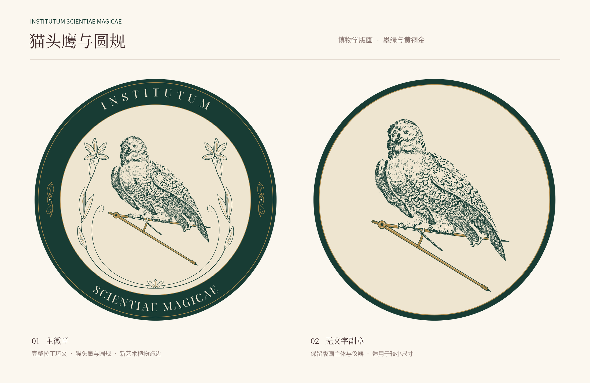

# Institutum Scientiae Magicae

猫头鹰与圆规的新艺术徽章。现有设计保持原样：双爪握住圆规的一条金属腿，另一条腿向下展开；鸢尾花叶与回卷长茎围绕主体。主徽章上弧为 `INSTITUTUM`，下弧为 `SCIENTIAE MAGICAE`，另提供无文字副章。



## 文件

| 路径 | 用途 |
| --- | --- |
| `svg/logo.svg` | 正式主徽章，纯矢量、文字已转曲 |
| `svg/logo-editable.svg` | 同一主徽章，拉丁环文保持可编辑 |
| `png/logo-preview.png` | 1600 × 1600 透明主徽章，独立图形文件 |
| `svg/logo-icon.svg` | 无文字副章 |
| `png/logo-icon.png` / `png/logo-icon-256.png` | 原有 512 × 512 / 256 × 256 透明副章 |
| `png/logo-icon-1600.png` | 同一副章的新增 1600 × 1600 高清导出，用于展示板 |
| `design-preview.png` | 2200 × 1430 统一展示板 |
| `assets/` | 原图、来源记录及提取后的猫头鹰矢量 |
| `scripts/` | 构建、导出与素材提取脚本 |

SVG 画板为 1000 × 1000，徽章外部透明。深墨绿 `#183C34`、暖象牙 `#EEE5D0` 与黄铜金 `#AC8A4D` 沿用原稿。主徽章建议显示宽度不小于 300 px，无文字副章不小于 160 px。

原有正式 SVG / PNG 在目录整理中保持原始字节；新增的高清副章由同一 SVG 导出，不改变设计。`png/logo-preview.png` 是独立的透明标志；根 `design-preview.png` 则是与另一套作品版式一致的展示板。仓库仅发布当前最新版，不包含历史稿件、备份目录或 ZIP。

## 来源与许可

猫头鹰来自大都会博物馆公有领域馆藏 [The Great White Owl](https://www.metmuseum.org/art/collection/search/750817)，1771 年，Anonymous, British, 18th century，馆藏编号 1999.291.3。项目清理原树枝，保留刻线与握爪；来源记录见 `assets/source.json`。

圆规、植物饰边、环带及构图由项目绘制。拉丁字体为 Noto Serif Display；正式版已转曲，编辑或重建文字需自行安装字体，并通过 `NOTO_SERIF_DISPLAY_FONT` 指定字体文件，避免静默替换。原创部分按 CC BY-NC 4.0 发布，署名 Aurora Lucas；完整来源与例外见根目录 [第三方说明](../THIRD_PARTY_NOTICES.md)和[许可](../LICENSE)。

## 预览与校验

以下命令均在仓库根目录执行，预览生成需要 Pillow：

```sh
python3 scripts/make_previews.py
python3 scripts/verify_assets.py
```

也可使用 `python3 institutum-scientiae-magicae-logo/scripts/make_preview.py` 调用共享预览入口。`PREVIEW_SANS_FONT`、`PREVIEW_SERIF_FONT` 可指定本机中文字体。预览只合成纸底与排版，不修改正式图形。

## 重新构建与导出

以下操作会覆盖对应正式产物，整理目录或调整预览时无需执行：

```sh
python3 institutum-scientiae-magicae-logo/scripts/design_logo.py
npm install
node institutum-scientiae-magicae-logo/scripts/finish_logo.cjs
```

`design_logo.py` 读取 `assets/owl-perching.svg` 与 `owl-perching-silhouette.svg`，生成可编辑主徽章和副章；`finish_logo.cjs` 使用 Noto Serif Display 转曲并输出正式 SVG / PNG，依赖根目录安装的 sharp 与 `@napi-rs/canvas`。

`extract_owl.py` 和 `extract_perching_owl.py` 记录原图裁切、去枝及矢量化方法，只有重新处理原图时才需执行，另需 Pillow、NumPy 与 vtracer。常规构建直接使用已经保存的矢量素材。
